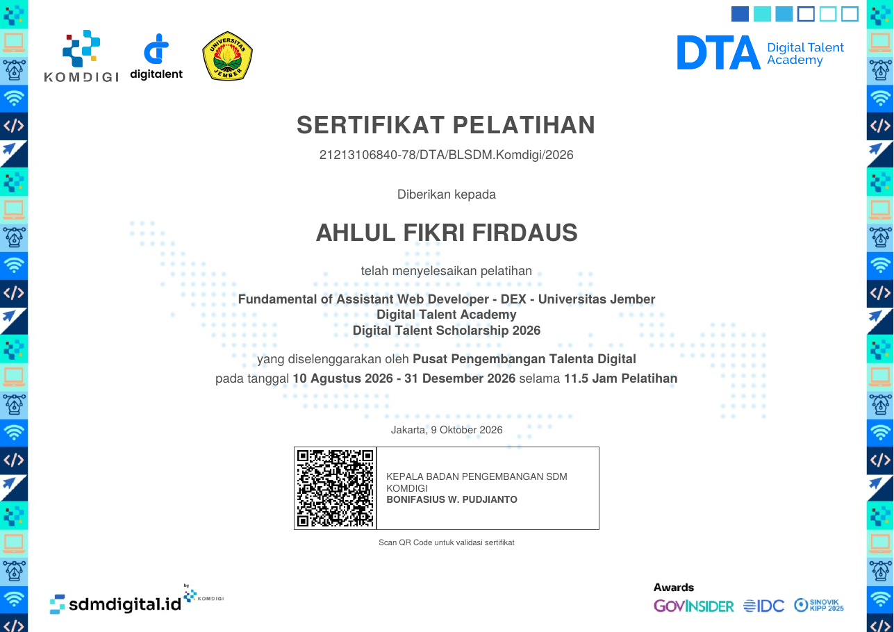

Nama : Ahlul Fikri Firdaus
 
NIM : 252410102050
 
Kelas : Pemrograman Berbasis Web B

## Sertifikat

Digital Talent Scholarship 2026 (Digital Talent Academy, Komdigi), diselenggarakan oleh Pusat Pengembangan Talenta Digital bersama Universitas Jember.

### Fundamental of Assistant Web Developer
10 Agustus – 31 Desember 2026 · 11,5 jam pelatihan

### Intermediate Assistant Web Developer
13 Agustus – 31 Desember 2026 · 12,5 jam pelatihan

*Klik gambar untuk membuka PDF. Keaslian sertifikat bisa dicek lewat QR code yang tercantum di dalamnya.*
